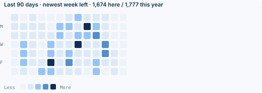

<a href="https://matthummel.com/"></a>

<a href="https://matthummel.com/hire/"></a>&nbsp;
<a href="https://matthummel.com/contact/"></a>&nbsp;
<a href="https://matthummel.com/projects/"></a>&nbsp;
<a href="https://matthummel.com/code/"></a>&nbsp;
<a href="https://www.linkedin.com/in/matt-hummel-pa"></a>

<sub><a href="#build">What I build</a> · <a href="#stack">Stack</a> · <a href="#projects">Latest projects</a> · <a href="#writing">Journal</a> · <a href="#oss">Open source</a> · <a href="#play">Branchborne</a> · <a href="#activity">Activity</a> · <a href="#devs">How I work</a> · <a href="#hire">Hire</a> · <a href="#connect">Connect</a> &nbsp;·&nbsp; </sub>

---

<a id="build"></a>
## What I build

<table>
  <tr>
    <td width="33%" valign="top">
      <strong>Custom WordPress on the Roots stack</strong><br />
      <sub>Bedrock · Sage 11 · Trellis · Acorn · Blade · Tailwind CSS · Vite</sub><br /><br />
      Themes and platforms that shop owners edit themselves. Core Gutenberg blocks, no page builder. Composer-managed WordPress, environment config in <code>.env</code>, Docker or Trellis for local and staging.
    </td>
    <td width="33%" valign="top">
      <strong>Plugins &amp; integrations</strong><br />
      <sub>PHP 8.3 · REST · WP-CLI · WooCommerce · GitHub Actions</sub><br /><br />
      Small plugins that do one job: bookings, SEO head output, table of contents, newsletter. Standard hooks, PHPDoc, an uninstall that uninstalls. CI builds the release zip; the site pulls it.
    </td>
    <td width="33%" valign="top">
      <strong>Web apps &amp; automation</strong><br />
      <sub>n8n · REST APIs · Supabase · Netlify · GitHub Actions</sub><br /><br />
      Small web apps and automations that sit beside WordPress: n8n workflows that post, sync, and notify; REST integrations; a Supabase-backed tool when a site needs an app. One admin for the shop, not five.
    </td>
  </tr>
</table>

<a id="stack"></a>
## Stack

<p align="center">
  <a href="https://matthummel.com/code/#skills">
    
  </a>
</p>

| Core | Why it is in the kit |
| --- | --- |
| **PHP 8.3** | Themes, plugins, and the APIs around them. Typed, Pint-formatted, WordPress coding standards. |
| **JavaScript / TypeScript** | Small, server-first UI behavior; React where an app really needs it. |
| **Tailwind CSS v4** | Design tokens in CSS, utilities in Blade, no bloat shipped. |
| **Docker** | Reproducible local WordPress and CI; the same containers for every project. |
| **Composer** | Bedrock-style WordPress: core, plugins, and the theme are dependencies, not uploads. |
| **n8n · Supabase · Netlify** | Automations and small apps around the site: workflows that post and sync, a database and auth when a site needs an app, static hosting for demos. |

<sub>Groups mirror <a href="https://matthummel.com/code/">matthummel.com/code</a>. The banner is an SVG this repo rebuilds on a schedule — glyphs from simple-icons, animation off when your OS asks for reduced motion.</sub>

---

<a id="projects"></a>
## Latest projects

The four newest on [matthummel.com/projects](https://matthummel.com/projects/), refreshed by this repo's Actions. Sample work I built in public — not client sites. Each one has a live demo and a repo.

<!--START_SECTION:projects-->
<table>
  <tr>
    <td width="300" valign="top"><a href="https://matthummel.com/projects/cobbleandcandle/"></a></td>
    <td valign="top">
      <strong><a href="https://matthummel.com/projects/cobbleandcandle/">Cobble &amp; Candle</a></strong><br />
      <sub>WordPress theme · Restaurant · tavern · inn · v0.1.0</sub><br />
      Cobble &amp; Candle is a WordPress block theme for restaurants, taverns and inns. Guests see live “open now” hours, menus they can filter by diet, and book a table or a room. Owners set it up in a five-step wizard, import…<br />
      <sub>28 custom blocks &nbsp;·&nbsp; 4 style directions &nbsp;·&nbsp; WCAG 2.2 AA tested</sub><br />
      <a href="https://matthummel.com/projects/cobbleandcandle/">Project page</a> · <a href="https://cobbleandcandle.matthummel.com/">Live demo</a> · <a href="https://github.com/matthummel-pa/wp-cobbleandcandle">GitHub</a>
    </td>
  </tr>
  <tr>
    <td width="300" valign="top"><a href="https://matthummel.com/projects/tocguide/"></a></td>
    <td valign="top">
      <strong><a href="https://matthummel.com/projects/tocguide/">TOCguide</a></strong><br />
      <sub>WordPress plugin · The table of contents that reads with your… · v1.5.0</sub><br />
      TOCguide is a WordPress plugin that builds a table of contents from the headings in a post. The outline is in the first HTML. An optional Reading Guide adds section previews, read time, and study tools — no accounts…<br />
      <sub>Free download &nbsp;·&nbsp; 1.5.0 TOCguide identity &nbsp;·&nbsp; Server rendered</sub><br />
      <a href="https://matthummel.com/projects/tocguide/">Project page</a> · <a href="https://matthummel-pa.github.io/tocguide/">Live demo</a> · <a href="https://github.com/matthummel-pa/tocguide">GitHub</a>
    </td>
  </tr>
  <tr>
    <td width="300" valign="top"><a href="https://matthummel.com/projects/walkridge/"></a></td>
    <td valign="top">
      <strong><a href="https://matthummel.com/projects/walkridge/">WalkRidge</a></strong><br />
      <sub>WordPress theme · Tours · guides · WooCommerce · v1.7.2</sub><br />
      WalkRidge is a WordPress theme for licensed-guide tour shops. Visitors browse tours, meet guides, and book online. Operators change brand, phone, and hours in Theme Settings — no code.<br />
      <sub>10 Gutenberg blocks &nbsp;·&nbsp; WooCommerce tour shop &nbsp;·&nbsp; GPL theme pack</sub><br />
      <a href="https://matthummel.com/projects/walkridge/">Project page</a> · <a href="https://walkridge.matthummel.com/">Live demo</a> · <a href="https://github.com/matthummel-pa/wp-walkridge">GitHub</a>
    </td>
  </tr>
  <tr>
    <td width="300" valign="top"><a href="https://matthummel.com/projects/acreline/"></a></td>
    <td valign="top">
      <strong><a href="https://matthummel.com/projects/acreline/">Acreline</a></strong><br />
      <sub>WordPress theme · Homes · neighborhoods · local agents · v1.5.9</sub><br />
      Acreline is a WordPress theme for solo agents and small teams. Featured homes, agent bios, and showing requests sit on Gutenberg marketing pages. I built it so an office can set it up in WordPress without a page builder.<br />
      <sub>21 Gutenberg blocks &nbsp;·&nbsp; 5 setup wizard steps &nbsp;·&nbsp; 8 color styles</sub><br />
      <a href="https://matthummel.com/projects/acreline/">Project page</a> · <a href="https://acreline.matthummel.com/">Live demo</a> · <a href="https://github.com/matthummel-pa/wp-acreline">GitHub</a>
    </td>
  </tr>
</table>
<!--END_SECTION:projects-->

<p align="center"><sub><a href="https://matthummel.com/projects/">All projects</a> · <a href="https://matthummel.com/hire/">Hire me to adapt one</a></sub></p>

<a id="writing"></a>
## Latest from the journal

Five newest posts from [matthummel.com/blog](https://matthummel.com/blog/) — WordPress, the Roots stack, web development, and how I actually work.

<!--START_SECTION:posts-->
<table>
  <tr>
    <td width="240" valign="top"><a href="https://matthummel.com/should-you-still-learn-to-code-in-2026-what-ai-changed-and-what-it-didnt/"></a></td>
    <td valign="top">
      <strong><a href="https://matthummel.com/should-you-still-learn-to-code-in-2026-what-ai-changed-and-what-it-didnt/">Should You Still Learn to Code in 2026? What AI Changed (and What It Didn’t)</a></strong><br />
      <sub>Oct 24, 2026</sub><br />
      Yes, you should still learn to code in 2026. But the reason changed: AI writes the code, and it doesn’t know when it’s wrong. Here’s what the research says to focus on.<br />
      <a href="https://matthummel.com/should-you-still-learn-to-code-in-2026-what-ai-changed-and-what-it-didnt/">Read the post →</a>
    </td>
  </tr>
  <tr>
    <td width="240" valign="top"><a href="https://matthummel.com/wordpress-7-2-beta-1/"></a></td>
    <td valign="top">
      <strong><a href="https://matthummel.com/wordpress-7-2-beta-1/">WordPress 7.2 Beta 1: What Changed for Developers</a></strong><br />
      <sub>Oct 23, 2026</sub><br />
      WordPress 7.2 Beta 1 landed October 20, 2026. It’s a testing release, not an update for live sites. Here’s what’s new and what developers should check before the December 8 final release.<br />
      <a href="https://matthummel.com/wordpress-7-2-beta-1/">Read the post →</a>
    </td>
  </tr>
  <tr>
    <td width="240" valign="top"><a href="https://matthummel.com/wordpress-72-release-date-features-and-what-to-test/"></a></td>
    <td valign="top">
      <strong><a href="https://matthummel.com/wordpress-72-release-date-features-and-what-to-test/">WordPress 7.2: Release Date, Features, and What to Test</a></strong><br />
      <sub>Oct 23, 2026</sub><br />
      WordPress 7.2 is scheduled to ship on December 8, 2026. Beta 1 landed October 20, and the first…<br />
      <a href="https://matthummel.com/wordpress-72-release-date-features-and-what-to-test/">Read the post →</a>
    </td>
  </tr>
  <tr>
    <td width="240" valign="top"><a href="https://matthummel.com/wordpress-7-2/"></a></td>
    <td valign="top">
      <strong><a href="https://matthummel.com/wordpress-7-2/">WordPress 7.2: Release Date, Features, and What to Test</a></strong><br />
      <sub>Oct 19, 2026</sub><br />
      WordPress 7.2 is set for December 8, 2026. See the beta schedule, the new Ipsum theme, Notes suggestion mode, the Secrets API, and how to test it.<br />
      <a href="https://matthummel.com/wordpress-7-2/">Read the post →</a>
    </td>
  </tr>
  <tr>
    <td width="240" valign="top"><a href="https://matthummel.com/claude-code-playbook-wordpress/"></a></td>
    <td valign="top">
      <strong><a href="https://matthummel.com/claude-code-playbook-wordpress/">Why I Built a Claude Code Playbook for WordPress</a></strong><br />
      <sub>Oct 15, 2026</sub><br />
      How one public repo of rules, skills and commands keeps Claude Code consistent across every WordPress project I work on, and syncs to every machine on merge.<br />
      <a href="https://matthummel.com/claude-code-playbook-wordpress/">Read the post →</a>
    </td>
  </tr>
</table>
<!--END_SECTION:posts-->

<p align="center"><sub><a href="https://matthummel.com/blog/">All posts</a> · <a href="https://matthummel.com/feed/">RSS</a> · <a href="https://dev.to/matthummeldev">DEV.to</a></sub></p>

---

<a id="oss"></a>
## Open source

| Repo | What it is | Stack |
| --- | --- | --- |
| [wp-cobbleandcandle](https://github.com/matthummel-pa/wp-cobbleandcandle) | Block theme for restaurants, taverns, and inns: live hours, diet-filtered menus, table and room bookings with iCal sync, setup wizard. | Sage 11 · Gutenberg · Alpine.js · Tailwind |
| [wp-acreline](https://github.com/matthummel-pa/wp-acreline) | Real estate theme: searchable listings with a map, agents, showing requests, 21 Gutenberg blocks, setup wizard. | Sage 11 · Gutenberg · Customizer |
| [wp-walkridge](https://github.com/matthummel-pa/wp-walkridge) | Tour-shop theme: tours, guides, and checkout through WooCommerce. | Sage 11 · WooCommerce · Gutenberg |
| [tocguide](https://github.com/matthummel-pa/tocguide) | Server-rendered Table of Contents block with an optional Reading Guide. Free, GPLv2+. | PHP · Gutenberg |
| [repofolio](https://github.com/matthummel-pa/repofolio) | Turn GitHub repos and site projects into a living portfolio for WordPress. | PHP · GitHub API · Gutenberg |
| [matthummel-theme](https://github.com/matthummel-pa/matthummel-theme) | The theme behind matthummel.com, including the live GitHub board and the social-share editor box. | Sage 11 · Blade · Tailwind v4 · Vite |
| [branchborne-gem-quest-game](https://github.com/matthummel-pa/branchborne-gem-quest-game) | Match-3 with a web-dev twist (below). | Vanilla JS canvas · Supabase · Netlify |

<sub>Every repo follows the same rules: a one-sentence description, topics like <code>wordpress</code> · <code>roots-sage</code> · <code>php</code> · <code>gutenberg</code>, a README with setup, stack, usage, and a visual overview, conventional commits that say <em>why</em>, and a <code>.gitignore</code> that keeps <code>.env</code>, <code>wp-config.php</code>, dumps, and build output out.</sub>

<a id="play"></a>
## Branchborne Gem Quest

Bejeweled-style match-3 with a web-dev twist — tech gems, pathway heroes (Frontend Mage, Backend Sentinel, WordPress Artisan, Full-Stack Ranger), live side quests, and a trophy case. Open source and looking for collaborators.

<table>
  <tr>
    <td width="300" valign="top">
      <a href="https://gregarious-custard-70cf58.netlify.app/"></a>
    </td>
    <td valign="top">
      Continuous cascades (HTML, CSS, JS, React, Git, Node, and more), Intern → Senior → Expert endgame, Dev tips on the quest rail, cloud saves via Supabase. Vanilla JS canvas engine plus a WordPress shortcode embed.<br /><br />
      <a href="https://gregarious-custard-70cf58.netlify.app/"></a>
      <a href="https://github.com/matthummel-pa/branchborne-gem-quest-game"></a><br />
      <sub><a href="https://matthummel-pa.github.io/matthummel-pa/">Pages mirror</a></sub>
    </td>
  </tr>
</table>

---

<a id="activity"></a>
## Public GitHub activity

Same idea as the live board on [matthummel.com/code](https://matthummel.com/code/): a custom 90-day heat map (newest week first, navy cells) plus the latest public pushes. Refreshed hourly from this repo's Actions — not a third-party stats card.

<!--START_SECTION:heatmap-->
<p align="center">
  <a href="https://matthummel.com/code/#gh-contributions">
    
  </a>
</p>

<sub>Custom calendar (not the GitHub default card). Newest week on the left, navy scale from [matthummel.com/code](https://matthummel.com/code/). 1,653 contributions in 90 days · 1,756 in the last year.</sub>
<!--END_SECTION:heatmap-->

### Feed

<!--START_SECTION:activity-->
| | Shipped | Repo | When |
| --- | --- | --- | --- |
| | 🔀 [Opened PR #8](https://github.com/matthummel-pa/ai-dev-standards-playbook/pull/8) — feat(sage): sage-project skill, /pb:new-theme and /pb:dev (1.4.… | [`ai-dev-standards-playbook`](https://github.com/matthummel-pa/ai-dev-standards-playbook) | just now |
| | ✅ [Merged PR #392](https://github.com/matthummel-pa/matthummel-theme/pull/392) — fix(shop): catalog refresh so the 3.17.5 edits reach Acreline a… | [`matthummel-theme`](https://github.com/matthummel-pa/matthummel-theme) | 11m |
| | ✅ [Merged PR #391](https://github.com/matthummel-pa/matthummel-theme/pull/391) — fix(shop): Acreline FAQ matches Coming soon, add a story link (… | [`matthummel-theme`](https://github.com/matthummel-pa/matthummel-theme) | 43m |
| | ✅ [Merged PR #390](https://github.com/matthummel-pa/matthummel-theme/pull/390) — copy(shop): plainer default copy on the shop pages (3.17.4) | [`matthummel-theme`](https://github.com/matthummel-pa/matthummel-theme) | 53m |
| | ✅ [Merged PR #389](https://github.com/matthummel-pa/matthummel-theme/pull/389) — fix(about): GitHub panel titles are H3, not H4 (3.17.3) | [`matthummel-theme`](https://github.com/matthummel-pa/matthummel-theme) | 1h |
| | ✅ [Merged PR #388](https://github.com/matthummel-pa/matthummel-theme/pull/388) — fix(shop): drop the duplicate TOCguide docs link (3.17.2) | [`matthummel-theme`](https://github.com/matthummel-pa/matthummel-theme) | 3h |
| | 🚀 [Commit](https://github.com/matthummel-pa/matthummel-theme/commit/81d63dc974348ae26bacb360ab2ee812e728ae14) — fix(shop): one-time catalog refresh so the 3.17.5 edits reach A… | [`matthummel-theme`](https://github.com/matthummel-pa/matthummel-theme) | 15m |
| | 🚀 [Commit](https://github.com/matthummel-pa/matthummel-theme/commit/fd8ba83e6b1ce7d168c184bd3a36d36f21191f4b) — fix(shop): Acreline FAQ matches Coming soon, add a story link (… | [`matthummel-theme`](https://github.com/matthummel-pa/matthummel-theme) | 44m |
| | 🚀 [Commit](https://github.com/matthummel-pa/matthummel-theme/commit/5a5a48f4e526edbe0554ec863ece91b5ced875e8) — fix(about): GitHub panel titles are H3, not H4, under the secti… | [`matthummel-theme`](https://github.com/matthummel-pa/matthummel-theme) | 1h |
| | 🚀 [Commit](https://github.com/matthummel-pa/matthummel-theme/commit/3609bcd3f9b302c5e95ed230fa97553eae06cce5) — chore(rules): .claude/rules is the only source; drop Cursor; st… | [`matthummel-theme`](https://github.com/matthummel-pa/matthummel-theme) | 4h |
| | 🚀 [Commit](https://github.com/matthummel-pa/matthummel-theme/commit/090750e0bf9b8062c7b0e35b40fb9195caf3e1a7) — feat(shop): vertical cards in two columns, tabs above the cards… | [`matthummel-theme`](https://github.com/matthummel-pa/matthummel-theme) | 15h |
<!--END_SECTION:activity-->

### Recently pushed

<!--START_SECTION:pushed-->
| Repo | Stack | Last push |
| --- | --- | --- |
| **[ai-dev-standards-playbook](https://github.com/matthummel-pa/ai-dev-standards-playbook)** — Rules, skills, slash commands and a deploy kit that teach Claude Code how to build Word… | Shell · ★0 | 1m |
| **[matthummel-theme](https://github.com/matthummel-pa/matthummel-theme)** — Sage 11 WordPress theme for matthummel.com — Blade, Tailwind v4, Vite. Portfolio and se… | PHP · ★2 | 15m |
| **[wp-cobbleandcandle-docs](https://github.com/matthummel-pa/wp-cobbleandcandle-docs)** — Documentation and support guides for the Cobble & Candle WordPress theme | Code · ★0 | 1d |
| **[wpdemo-dobbinhouse](https://github.com/matthummel-pa/wpdemo-dobbinhouse)** — Public work from Gettysburg. | PHP · ★0 | 3w |
<!--END_SECTION:pushed-->

<p align="center"><sub>Full calendar, badges, and repo cards: <a href="https://matthummel.com/code/">matthummel.com/code</a></sub></p>

---

<a id="devs"></a>
## How I work

Seventeen years of in-house web work (higher-ed marketing sites, then internal web apps and workflow tools for large teams). Now WordPress full-time. Public GitHub is the trail I started in 2025 — most earlier production code still lives behind employer walls.

| | The useful version |
| --- | --- |
| **Day job shape** | I write PHP, Blade, and just enough JS/TS. I am not a designer — I will refer one. |
| **Happy path** | Bedrock + Sage 11 + Trellis, Acorn, Blade, Tailwind v4, Vite, PHP 8.3, WordPress 6.6+, Core Gutenberg (no page builder). |
| **Plugins** | One job each. PHPDoc, standard hooks, uninstall that actually uninstalls. |
| **Automation** | n8n for the glue: publish, sync, notify. Every workflow has an error branch and a log the client can read. |
| **AI** | Claude Code scaffolds. I still read, click, and test every line that ships. |
| **PRs I like** | Small, named after the change, conventional commits (`feat`, `fix`, `docs`). Tell me how you tried it. |
| **PRs I bounce** | Drive-by refactors, page-builder add-ons, and "while I was here" diffs. |
| **Handoff** | Domain, hosting, repo, and database in the client's name. Short admin notes in plain English. |
| **Agency mode** | Silent sub is fine. You keep the client. I stay off their Slack unless you ask. |
| **Hours** | America/New_York. Async first. Overlap afternoons ET for pairing. |
| **A11y** | Keyboard paths, contrast, semantic HTML. If a shop owner cannot tab it, it is not done. |

<details>
  <summary><strong>How to drop me into a repo</strong></summary>

```text
1. Node + Composer + a local WordPress (Docker, Trellis, Studio, or wp-env). PHP 8.3.
2. Theme: composer install && npm install && npm run build
3. Do not install Elementor / ACF "because the last theme had it".
4. Open a draft PR early. I review staged URLs, not zip files in Drive.
5. If it is agency overflow: send brand, IA, and who owns hosting first.
```

</details>

<details>
  <summary><strong>package.json vibes</strong></summary>

```json
{
  "name": "matt-hummel",
  "version": "17.0.0",
  "private": false,
  "description": "WordPress developer · Roots stack · themes, plugins, and web apps · open for work",
  "homepage": "https://matthummel.com",
  "main": "WordPress + Roots (Bedrock · Sage 11 · Trellis)",
  "scripts": {
    "dev": "code . && coffee --watch",
    "build": "ship accessible WordPress platforms",
    "test": "a11y + Core Web Vitals + 'can the shop edit it?'",
    "play": "open https://gregarious-custard-70cf58.netlify.app/",
    "deploy": "you own the keys"
  },
  "dependencies": {
    "wordpress": "specialty",
    "roots/bedrock": "*",
    "roots/sage": "^11",
    "roots/trellis": "*",
    "php": "8.3",
    "tailwindcss": "^4",
    "docker": "*",
    "n8n": "glue",
    "curiosity": "*",
    "patience": "^∞"
  },
  "devDependencies": {
    "claude": "coworker",
    "claude-code": "pair-programmer",
    "bad-pun-generator": "optional"
  },
  "engines": {
    "node": ">=human",
    "coffee": "required",
    "timezone": "America/New_York"
  },
  "keywords": ["wordpress", "roots-sage", "php", "gutenberg", "gettysburg", "a11y", "open-for-work"],
  "license": "MIT-and-kindness"
}
```

</details>

<a id="hire"></a>
## Open for work

**Freelance · contract · full-time · agency overflow.** Custom WordPress on the Roots stack, plugins and integrations, and the web apps and automations around them. Based in Gettysburg, PA. Remote anywhere. I usually reply within one business day (ET).

**[Hire me](https://matthummel.com/hire/)** · **[Write a note](https://matthummel.com/contact/)** · **[LinkedIn](https://www.linkedin.com/in/matt-hummel-pa)**

<a id="stats"></a>
## GitHub stats

<p align="center">
  
</p>

<table align="center">
  <tr>
    <td valign="top" width="50%">
      
    </td>
    <td valign="top" width="50%">
      
    </td>
  </tr>
</table>

<a id="connect"></a>
## Connect

- 🌐 **Website:** [matthummel.com](https://matthummel.com)
- 🧪 **Live demos:** [cobbleandcandle.matthummel.com](https://cobbleandcandle.matthummel.com/) · [acreline.matthummel.com](https://acreline.matthummel.com/) · [walkridge.matthummel.com](https://walkridge.matthummel.com/)
- 📬 **Hire / contact:** [matthummel.com/hire](https://matthummel.com/hire/) · [matthummel.com/contact](https://matthummel.com/contact/)
- 🧩 **Projects + code:** [matthummel.com/projects](https://matthummel.com/projects/) · [matthummel.com/code](https://matthummel.com/code/)
- 💼 **LinkedIn:** [linkedin.com/in/matt-hummel-pa](https://www.linkedin.com/in/matt-hummel-pa)
- ✍️ **Dev.to:** [dev.to/matthummeldev](https://dev.to/matthummeldev)
- 🦋 **Bluesky:** [@matthummel](https://bsky.app/profile/matthummel.bsky.social)
- 👽 **Reddit:** [u/matt-hummel](https://www.reddit.com/user/matt-hummel)
- 📡 **RSS:** [matthummel.com/feed](https://matthummel.com/feed/)
- 🎮 **Branchborne Gem Quest:** [Play live](https://gregarious-custard-70cf58.netlify.app/) · [Game repo](https://github.com/matthummel-pa/branchborne-gem-quest-game)

<sub>WordPress developer · Roots stack · themes, plugins, and web apps — open for work. PRs welcome; puns tolerated.</sub>
